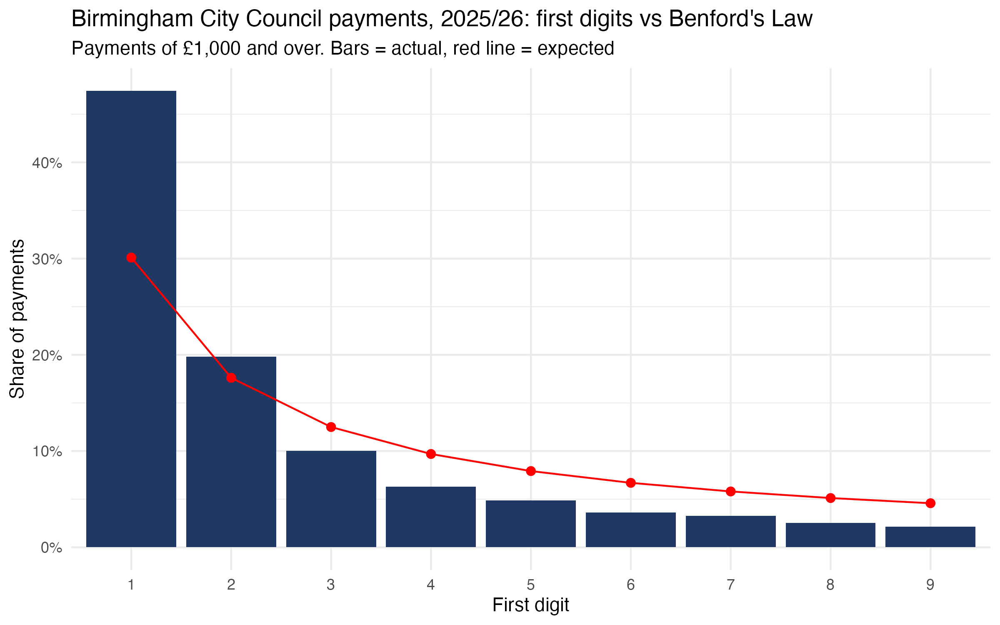
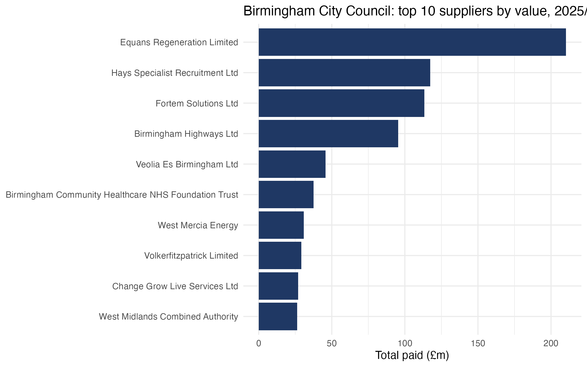

# Council payments audit analytics (2025/26)

I'm studying at the University of Birmingham and applying for audit roles. I did KPMG's audit job simulation, and wanted to try similar work on real data. My aim was to see what stood out and investigate what an auditor would want to look into further. 
I decided to use my own council's data. Birmingham City Council publishes every payment it makes over £500, so I took the 2025/26 financial year and ran some of the checks auditors use on payment data.

## The data
- Birmingham City Council, Payments to Suppliers over £500 (Open Government Licence)
- https://cityobservatory.birmingham.gov.uk/explore/dataset/payments-to-suppliers-over-gbp500/
- 1 April 2025 to 31 March 2026: 110,426 payments, £1.81bn in total
- No missing or negative amounts. The smallest payment is £500, which matches what the council says it publishes
- I haven't uploaded the raw data because the file is too big, but it's free to download from the link

## What I checked
I started with what could go wrong with a council's payments and picked a test for each:
- Paying the same invoice twice (duplicate payments)
- Amounts that are estimates or typed in rather than taken from an invoice (round-number payments)
- Numbers that don't follow the pattern real financial data usually does (Benford's Law)
- A lot of money going to a small number of suppliers (top 10 suppliers by value)

## What I found

Benford's Law didn't work quite how I expected. I ran it on the 75,287 payments of £1,000 or more and it came out as a poor fit (MAD 0.043, anything over 0.015 counts as poor). Nearly half the payments (47.4%) started with a 1, when Benford says it should be about 30%. However I don't believe that means anything's wrong with the payments as the council only publishes payments over £500 and most payments are towards the bottom end (median is £1,562), so the numbers aren't spread out enough for the test to be a reliable indicator.

Duplicate payments: Level 1 (same payee, amount and date) found 700 extra payments worth £2.99m. Level 2 also matched on department and cost centre, which cuts out a lot of normal payments, and found 116 extra payments worth £2.27m (about 0.1% of spend). 94 of the 114 Level 2 groups (82%) came from the Adult Care Packages cost centre. That looks like it's to do with how care package payments are made rather than one-off mistakes. It could be normal or a batch paid twice, and the invoices would show which. These are possible duplicates, not confirmed ones.

Round-number payments: I found here that not many payments were round. 1,245 (1.1%) were exact multiples of £1,000, worth £39.9m, or 2.2% of the money. What did stand out, was where they were: being almost half were in the GRNI account (goods received but not invoiced yet), where a round amount may potentially mean they paid the purchase order figure instead of the invoice. Legal fees also had 285. Then by using £500 as the cut-off, it gave 2,757 (2.5%) and so the result didn't really change.

Top 10 suppliers: I found that 40.4% of the year's spend (about £733m) went to 10 suppliers. Equans Regeneration got the most, £210.3m (11.6%) from 73 payments. Extra Personnel was paid more times than anyone (12,665 payments) but only received 0.7% of the money, showing being paid often differs from being paid the most.

## Limitations
- 3,134 payments (£11.9m, 0.7% of the money) have the payee redacted as personal data, mostly in adult social care. I left them out of the duplicate and supplier checks because lots of different people share one label. However, as they are overall a small share I don't think they shift the results
- Only payments over £500 are published, which is also why Benford didn't work well here
- Some labels aren't consistent. Redacted payments appear under two slightly different labels, and a couple of directorates appear under two versions of their name
- Without the invoices I can only flag things worth looking at, not say whether anything is actually wrong

## What I'd do next
I can't go further without the invoices, but if I had access to them I'd check the Adult Care Packages duplicates and some of the round-number GRNI payments.

## Files
- 01_load.R: loads the data and has a first look
- 02_clean.R: picks the financial year and checks the data is complete
- 03_benford.R, 04_duplicates.R, 05_round_number_payments.R, 06_top_suppliers.R: the tests
- findings.md: my working notes

I'm still currently developing my skills in R, so I used AI to help me write the code, structure and build this write up. I chose what to test based on what could go wrong, ran everything and checked the results myself.